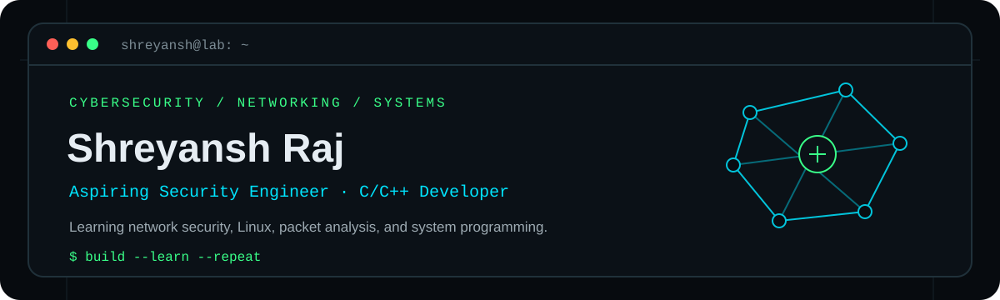
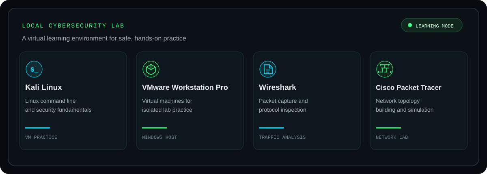

  
   
  

  <a href="https://github.com/ShreyanshRaaJ">GitHub</a> ·
  <a href="https://www.linkedin.com/in/shreyansh-raj-53aa91435/">LinkedIn</a> ·
  <a href="https://www.instagram.com/shreyansh_rrj/">Instagram</a> ·
  <a href="https://shreyanshraj.work/">Portfolio</a>

## 01 / About Me

I’m a B.Tech student building toward a career as a **Cybersecurity Engineer**. I’m interested in computer networking, network security, Linux, and system programming. I’m developing my foundations in C and C++ while learning how traffic moves across real networks and how to study it responsibly.

My current setup is a Windows workstation with VMware Workstation Pro. I’m building a Linux/Kali practice environment in VMware and learning with Wireshark and Cisco Packet Tracer. I’m a learner and project builder—not a professional penetration tester.

## 02 / My Cybersecurity Lab

  

| Tool | What I use it to learn |
| --- | --- |
| **Kali Linux** | Linux command line and security fundamentals in a virtual lab |
| **VMware Workstation Pro** | Running isolated virtual machines for hands-on practice |
| **Wireshark** | Capturing and inspecting network packets and protocols |
| **Cisco Packet Tracer** | Building and simulating network topologies |

## 03 / Tech Stack

| Area | Tools and topics |
| --- | --- |
| **Programming** | `C` · `C++` |
| **Operating systems** | `Windows` · `Linux` · `Kali Linux` |
| **Networking** | `TCP/IP` · `Networking fundamentals` · `Wireshark` · `Cisco Packet Tracer` |
| **Development tools** | `VMware Workstation Pro` · `Visual Studio Code` · `Git` · `GitHub` |

## 04 / Currently Learning

- Linux command line and Kali Linux fundamentals
- Computer networking and TCP/IP
- Network security and packet analysis
- Cybersecurity fundamentals and responsible security research
- C++ programming and system programming

## 05 / Featured Projects

<table>
  <tr>
    <td width="50%" valign="top">
      <h3><a href="https://github.com/ShreyanshRaaJ/Network-Intelligence">NETSCOPE · Network Intelligence</a></h3>
      
A network traffic monitoring and analysis dashboard project. The repository includes the project report, output, classroom work, and source-code document.

      
<code>Networking</code> <code>Packet analysis</code> <code>Wireshark / TShark</code>

    </td>
    <td width="50%" valign="top">
      <h3><a href="https://github.com/ShreyanshRaaJ/Portfolio">Personal Portfolio</a></h3>
      
A personal website built with HTML and published at <a href="https://shreyanshraj.work/">shreyanshraj.work</a>.

      
<code>HTML</code> <code>Web development</code>

    </td>
  </tr>
  <tr>
    <td width="50%" valign="top">
      <h3><a href="https://github.com/ShreyanshRaaJ/Biriyani_Project">KUKKDU-KU · Chicken Biryani</a></h3>
      
A single-page restaurant website project.

      
<code>HTML</code> <code>CSS</code>

    </td>
    <td width="50%" valign="top">
      <h3><a href="https://github.com/ShreyanshRaaJ/WEB-D-ECE">Web Development Practice</a></h3>
      
HTML/CSS experiments and workshop assignments covering page structure, forms, accessibility, tables, and navigation.

      
<a href="https://github.com/ShreyanshRaaJ/-WebD-Workshop-Assignments">Workshop assignments</a> · <code>HTML</code> · <code>CSS</code>

    </td>
  </tr>
</table>

## 06 / GitHub Activity

  
  

  

  

Stats cards use public GitHub activity and may take a little time to refresh.

---

Building fundamentals, one packet and one program at a time.

